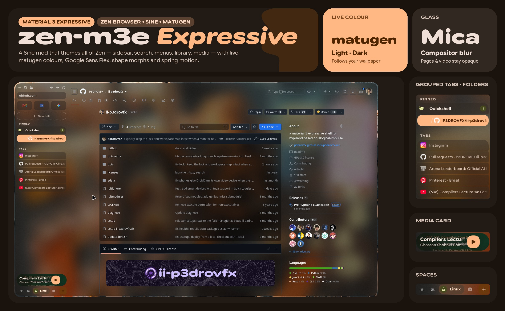

# zen-m3e



**Material 3 Expressive for [Zen Browser](https://zen-browser.app)**, as a
[Sine](https://github.com/CosmoCreeper/Sine) mod. Colours come live from
**[matugen](https://github.com/InioX/matugen)** (light and dark), type is
**Google Sans Flex** with its variable axes, shapes morph instead of spinning, motion uses
the M3E spring curves — and on Linux the window can be **glass** (compositor blur) while
pages and video stay opaque, like Zen's Mica on Windows.

It is the browser half of the design language of
[ii-p3drovfx](https://github.com/P3DROVFX/ii-p3drovfx) (an illogical-impulse Quickshell
shell for Hyprland), but it works on any Linux desktop with Zen, Sine and matugen.

---

## What it themes

- **Sidebar, reorganised** so your tabs start high: URL field · essentials · dashed
  *New tab* chip · **PINNED** (pinned tabs and folders as rows — a closed folder is one row
  with a favicon preview and a count) · **TABS**. Every list is a grouped shape whose
  current row becomes a primary pill while its neighbours round towards it. The current
  space is a chip in the foot that expands with its name. Lists fade at their edges
  instead of drawing lines. A collapsed (icons-only) variant keeps every icon centred.
- **Search overlay** — a Clover-4 badge that morphs into Sunny while you type, a *top
  result* hero card with an "Open ↵" pill and a clipped ornament, the other results as a
  grouped list, wide display-face headings.
- **Menus and the app menu** in the shell's style: separate rounded rows, icons in
  circular badges (Zen's icon set mapped onto context menus), M3 checkboxes and radios.
- **Site panel** (extensions popover), **Library**, **find bar**, **toasts**, **tooltips**.
- **Media player** like Android's: album art under a scrim, a big play/pause (rounded
  square ↔ circle), wavy progress; contracted by default, full on hover.
- **Motion** — springs on shape and position, selection pops, folders dealing in;
  nothing loops; reduced motion honoured. **No shadows**: surfaces separate by tone.

## Requirements

| | |
|---|---|
| **Zen Browser** with **Sine** | tested on Zen 1.22.x (native build) |
| **matugen** ≥ 4 | optional — without it a built-in amber palette is used |
| **Google Sans Flex** (variable) | installed for you if missing (SIL OFL 1.1, from google/fonts) |
| `bash`, `python3`, `fontconfig`, `curl` | for `install.sh` (`curl` only to fetch the font) |
| A compositor that blurs translucent windows | only for *glass* (Hyprland tested) |

## Install

One installer for everyone. Close Zen first (Sine rewrites `mods.json` while it runs):

```sh
git clone https://github.com/P3DROVFX/zen-m3e ~/Projects/zen-m3e
cd ~/Projects/zen-m3e
./install.sh --source ~/Pictures/wallpaper.jpg
```

| Option | |
|---|---|
| `--source IMAGE` / `--source '#rrggbb'` | first palette from your wallpaper or a colour |
| `--copy` | copy instead of symlink (default symlink: `git pull` + restart updates it) |
| `--profile DIR` | a profile other than the default (`~/.zen`, or the Flatpak's) |
| `--no-matugen` | don't touch matugen; use the built-in palette |
| `--no-font-download` | don't fetch Google Sans Flex if it isn't installed |
| `--glass` | glass window — see [Glass](#glass-transparent-zen) |
| `--uninstall` | remove the mod and its matugen block (backups are kept) |

What it does:

1. links (or copies) the mod into `<profile>/chrome/sine-mods/m3-expressive` and adds it
   to Sine's `mods.json`;
2. finds your variable Google Sans Flex — or, if there is none, downloads it from
   [google/fonts](https://github.com/google/fonts/tree/main/ofl/googlesansflex) (pinned
   commit, SHA-256 checked) into `~/.local/share/fonts` — and copies it into the mod:
   Gecko only applies variable-font axes in the browser UI to a face loaded through
   `@font-face`;
3. appends the template to `~/.config/matugen/config.toml` (created if missing), so every
   later `matugen` run also recolours Zen;
4. renders a first palette from `--source`.

Start Zen and open **Settings → Sine**: **M3 Expressive** is there with its preferences.
Disable **SuperPins**, **MatugenZen** and **Transparent Zen** if you have them — this mod
replaces all three.

To let the mod's script run (live palette reload, folder previews, album art), set
`sine.allow-unsafe-js` to `true` in `about:config`: Sine only runs scripts of locally
installed mods with it. Everything else works without it.

**On ii-p3drovfx** there is nothing to add: without `--source` the installer takes the
shell's current colour, and from then on the shell's own matugen run recolours Zen on
every wallpaper change and light/dark switch. Keep **Light / dark** on *Follow the shell*.

**Everywhere else**, run matugen when your wallpaper changes (`matugen image ~/wall.jpg -m dark`,
or from your wallpaper tool); Zen follows within seconds (on restart without the script).
If your desktop switches light/dark without re-running matugen, set **Light / dark** to
*Follow the system*.

## Glass (Transparent Zen)

Glass replaces [Transparent Zen](https://github.com/sameerasw/zen-themes/tree/main/TransparentZen):
the browser UI turns translucent and your compositor's blur shows through the sidebar,
top bar, gaps and empty tabs, while web pages and video stay opaque. With Zen closed:

```sh
./install.sh --glass
```

It turns on `zen.widget.linux.transparency` (window alpha),
`browser.tabs.allow_transparent_browser` and `m3e.translucent`, and moves out old
`userChrome.css` / `userContent.css` rules that force *every* page transparent (backups
as `*.bak-zen-m3e`).

- **Sites** decide for themselves — in practice the **Zen Internet** add-on, whose per-site
  styles ([sameerasw/my-internet](https://github.com/sameerasw/my-internet)) clear a
  site's background so the glass shows through, as on Windows.
- **Tint** — *Glass tint* light / medium / strong in the mod's settings.
- **Menus** are separate popups and stay nearly opaque unless your compositor blurs
  popups (Hyprland: `decoration { blur { popups = true } }`); then tick *Translucent
  menus too*.

## Preferences

All in **Settings → Sine → M3 Expressive**.

| Preference | |
|---|---|
| `m3e.scheme` | light/dark: follow the shell (matugen's mode), the system, or force one |
| `m3e.colors-path` | another palette file (empty = the mod's `colors.css`) |
| `m3e.translucent`, `m3e.translucent-strength`, `m3e.translucent-popups` | glass |
| `m3e.media-expanded` | always show the full media card |
| `m3e.essentials.width` / `.gap` / `.no-grow` / `.transparent` | essentials tiles |
| `m3e.favicon-size` | 16 / 18 / 20 px (default 20) |
| `m3e.dim-unloaded` | dim tabs that aren't loaded yet |
| `m3e.show-sidebar-scrollbar` | bring the scrollbar back |
| `m3e.system-font`, `m3e.reduced-motion` | system font; no springs |

## Limitations

- **Zen updates can break parts of it.** The mod styles Zen's own markup; it was built
  against Zen 1.22.x.
- **Glass needs a blurring compositor.** On KDE (KWin), GNOME, sway or niri the window
  turns translucent but unblurred — keep glass off there. Per-compositor details in
  [`docs/compatibility.md`](docs/compatibility.md).
- **Nothing floating over a page is see-through.** Gecko's `backdrop-filter` can't blur
  web content (it renders in another process), so the search overlay, compact sidebar
  and find bar stay nearly opaque.
- **The library button is placed in the top bar by CSS**, assuming that toolbar's
  default order; a heavily customised top bar can push it out of place.
- **Without the script** there is no live reload, folder preview, album art, scroll-edge
  fades or hidden scrollbar.

## Documentation

| | |
|---|---|
| [`docs/compatibility.md`](docs/compatibility.md) | what is generic, what is tied to ii / Hyprland, glass by compositor |
| [`docs/design.md`](docs/design.md) | tokens, where each M3E technique lives, type, elevation, motion |
| [`tests/README.md`](tests/README.md) | the sandboxed visual-test setup |
| [`CHANGELOG.md`](CHANGELOG.md) | every release |

## Contributing

```
src/           the stylesheet, one file per area (tokens, sidebar, urlbar, menus, …)
m3e.uc.js      the optional runtime script
matugen/       the matugen template
build.py       src/*.css → chrome.css; generates the palette, shapes and menu icons
tools/         banner.py (this README's banner)
tests/         Marionette client and screenshot scenes
```

Edit `src/`, then run `./build.py` — never edit `chrome.css`. With the default symlink
install, restart Zen to see changes. Visual checks run in a sandboxed, headless Zen so
they never touch your own browser ([`tests/README.md`](tests/README.md)). Keep to the
rules in [`docs/design.md`](docs/design.md): tokens only, no lines or shadows, one
technique per place, nothing that loops.

## Credits

- **[Zen Browser](https://zen-browser.app)** and **[Sine](https://github.com/CosmoCreeper/Sine)**.
- **[SuperPins](https://github.com/CosmoCreeper/Zen-Themes/tree/main/SuperPins)** — the
  essentials and tab-row options are adapted from it (MIT, © 2025 JLBlk, CosmoCreeper and
  contributors).
- **[Transparent Zen](https://github.com/sameerasw/zen-themes/tree/main/TransparentZen)**
  and **Zen Internet** by [sameerasw](https://github.com/sameerasw) — glass builds on the
  same Zen prefs and works hand in hand with Zen Internet's site styles.
- **[matugen](https://github.com/InioX/matugen)** by InioX.
- **Google Sans Flex** and **Material 3 Expressive** by Google.
- **[illogical-impulse](https://github.com/end-4/dots-hyprland)** by end-4, the shell
  ii-p3drovfx grows from.

## License

[MIT](LICENSE). Google Sans Flex is © The Google Sans Flex Authors, under the
[SIL Open Font License 1.1](https://openfontlicense.org); it isn't stored in this
repository — the installer uses your copy or fetches the official one (with its `OFL.txt`).
