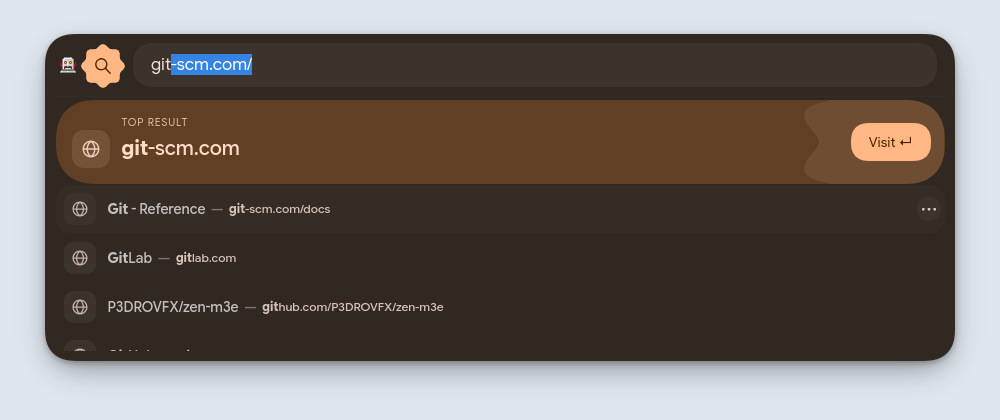
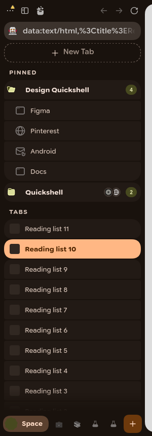
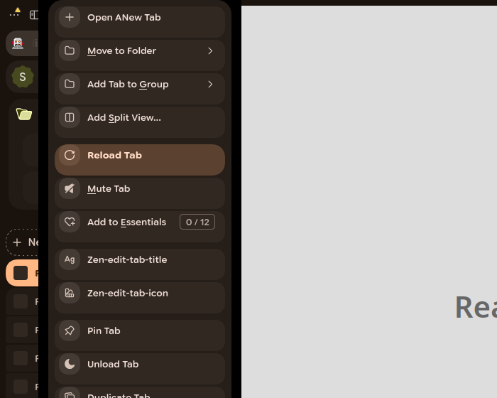
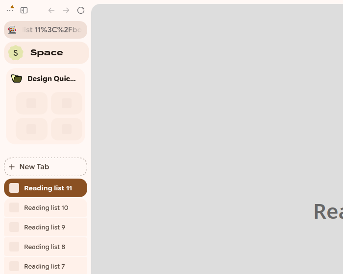

# M3 Expressive for Zen

A [Sine](https://github.com/CosmoCreeper/Sine) mod that brings Material 3 Expressive to
[Zen Browser](https://zen-browser.app): the colours come from **matugen** (light and dark),
the type is **Google Sans Flex** with its variable axes, shapes morph instead of spinning,
and motion uses the M3E spring curves.

It is the browser half of the ii shell's design language: same tokens, same surface
ladder, same curves (`Appearance.animationCurves`), same rules (`docs/design.md`).



| Sidebar | Menu | Light |
|---|---|---|
|  |  |  |

## What it themes

- **Sidebar** — reorganised so your tabs start high. Top bar (with the library moved up),
  URL field, essentials; then a **PINNED** caption over pinned tabs and folders as rows
  (a closed folder is one row with a favicon preview and a count; an open one lists its
  tabs indented under it); then a **TABS** caption over the tab list. The dashed "New tab" chip sits at the
  top, outside the scrolling area. Every list is a grouped shape: joins, outer corners, the current tab a
  primary pill with its neighbours rounding in and its label gaining weight. The space
  header is gone: the current space's chip in the foot expands with its name and its
  mark in a morphing cookie. Lists fade at their edges while scrolling, no divider lines.
- **Search overlay** (floating URL bar) — a sheet with a Clover-4 badge that morphs into
  Sunny while you type, the query in a filled pill, the first result as a **top result**
  hero card (primary container, caption, title, an "Open ↵" pill that springs in, a
  clipped scallop ornament); the other results are a grouped list with the shell's
  dynamic radius (joins, outer corners, the current row as a pill with neighbours rounding
  in). Group headings in the wide face, favicon tiles, condensed urls, engine chips.
- **Menus and the app menu** — the shell's menu: every item its own rounded row with a
  gap, the icon in a circular badge (Zen's icon set mapped onto context-menu items),
  wider gaps between groups, active rows fill and round further, content springs in.
- **Media player** — Android-style card: album art under a scrim, big play/pause
  (rounded square ↔ circle), wavy progress while playing.
- **Library** — the navigation rail, search pill, filter chips, caption headings,
  favicon tiles and scroll fade.
- **Also** — tooltips (inverse surface), find bar, toasts as snackbars, notifications,
  glance and split view, scrollbars, focus rings.

## Install

Requirements: Zen with Sine, `matugen` ≥ 4, the Google Sans Flex variable font.

The installer copies the font into the mod (`fonts/`): Gecko ignores
`font-variation-settings` in the browser UI for a font that only comes from the system,
so the width/weight axes need the `@font-face` the mod declares.

```sh
git clone https://github.com/P3DROVFX/zen-m3e ~/Projects/zen-m3e
cd ~/Projects/zen-m3e
# close Zen first
./install.sh            # symlinks the repo into the default profile, hooks matugen
```

`install.sh` adds the mod to `sine-mods/mods.json`, appends a marked block to
`~/.config/matugen/config.toml` (backup next to it) and renders a first palette from the
shell's current source colour. `./install.sh --uninstall` reverts both.

Then disable **MatugenZen**, **Transparent Zen** and **SuperPins** in Sine: this mod replaces them
(for Transparent Zen's effect, see *Glass* below).

## Glass (translucent window)

Like Zen's Mica on Windows: the browser UI is translucent and the compositor's blur
(Hyprland) shows through the sidebar, top bar, gaps and empty tabs, while **web pages
and video stay opaque**. With Zen closed:

```sh
./install.sh --glass
```

It turns on `zen.widget.linux.transparency` (window alpha), `m3e.translucent` and
`browser.tabs.allow_transparent_browser`, and moves out userChrome/userContent rules that
force *every* page transparent (backups as `*.bak-zen-m3e`). Replaces Transparent Zen.

Which sites go transparent is then up to the sites — in practice
[Zen Internet](https://github.com/sameerasw/zen-internet), whose per-site styles clear a
site's background so the glass shows through, as on Windows. Sites it doesn't style, and
video, keep their own opaque background.

- One translucent layer paints the window (`--m3e-glass`, Glass tint: light / medium /
  strong); everything else in the window is transparent so the tint stays even.
- Things that float over the page (search overlay, compact sidebar, find bar) are nearly
  opaque: Gecko's `backdrop-filter` can't blur web content (it renders in another
  process — checked on Hyprland), so a see-through overlay would show a sharp page.
- Menus are separate popups; Hyprland only blurs them with `decoration:blur:popups`.
  Enable that, then "Translucent menus too".

## Colour and light/dark

matugen writes `colors.css` (both palettes + the shell's mode) next to `chrome.css`,
which imports it. No script is needed for that; the palette updates on the next start.

`m3e.uc.js` adds a live reload (a cheap `stat` every 2.5 s, paused while the window is
hidden) and the popup entrance flag. Sine runs scripts of locally installed mods only when
`sine.allow-unsafe-js` is `true`.

| Preference | Values |
|---|---|
| `m3e.scheme` | `shell` (matugen mode), `system`, `light`, `dark` |
| `m3e.colors-path` | another palette file (empty = the mod's `colors.css`) |
| `m3e.translucent` | glass: translucent browser UI, opaque pages (see above) |
| `m3e.translucent-strength` | glass tint: `light` / `medium` / `strong` |
| `m3e.translucent-popups` | translucent menus (needs Hyprland popup blur) |
| `m3e.system-font` | use the system font instead of Google Sans Flex |
| `m3e.reduced-motion` | no springs or staggered entrances (the OS setting is honoured too) |
| `m3e.essentials.width` | `thin` / `normal` / `wide` essentials tiles |
| `m3e.essentials.gap` | `small` / `normal` / `big` gap between essentials |
| `m3e.essentials.no-grow` | keep essentials at a fixed width instead of filling the row |
| `m3e.essentials.transparent` | transparent essentials until hovered or current |
| `m3e.favicon-size` | `small` 16 / `normal` 18 / `large` 20 px (default large) |
| `m3e.dim-unloaded` | dim tabs that aren't loaded yet |
| `m3e.show-sidebar-scrollbar` | bring the sidebar scrollbar back (hidden by default) |

## Weight

`chrome.css` is ~65 KiB of plain CSS parsed once. No `backdrop-filter`, no infinite
animations, no broad `:has()`; transitions are on transform, opacity, colour and radius.
The script does one `stat` per 2.5 s while visible.

## Develop

```sh
./build.py          # src/*.css -> chrome.css; regenerates the matugen template,
                    # the fallback palette and the shape polygons
```

Edit `src/`, never `chrome.css`. Visual tests run in a sandboxed, headless Zen — see
[`tests/README.md`](tests/README.md).

## Credits

The essentials and tab-row options (tile width, gap, auto-grow, favicon size, hidden
scrollbar, dimmed unloaded tabs) are adapted from
[SuperPins](https://github.com/CosmoCreeper/Zen-Themes/tree/main/SuperPins) — MIT,
© 2025 JLBlk, CosmoCreeper and contributors.
